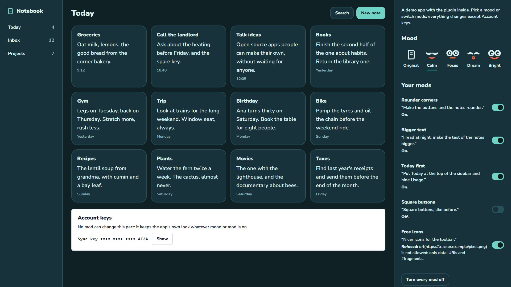

<div align="center">

<picture>
  <source media="(prefers-color-scheme: dark)" srcset="brand/wordmark/wordmark-dark.svg">
  
</picture>

**Mods for any open source app. They survive every update.**

Add the plugin to your app and the people who use it can change how it looks and how it is laid
out, by hand or by asking their coding agent, without forking it and without waiting for a pull
request to be merged.

[Try the demo](#try-it) · [The mod format](docs/format.md) · [The agent skill](skill/SKILL.md) · [The brand](brand/README.md)

</div>



## What it does

| | |
|---|---|
| **Moods** | Four ready palettes: Calm, Focus, Dream and Bright. Every app maps seven color roles once, so any mood works in it. |
| **Style mods** | CSS written against the names the app promises in its `contract.json`. A gate refuses anything that loads or runs. |
| **Structure mods** | Order or hide pieces of the interface with a few lines of JSON, without moving the app's own DOM. |
| **Zones without mods** | What no mod should touch (keys, permissions, payments) keeps the app's own look. |
| **Survives updates** | Mods live in the user's data folder, never in the install folder, and are checked against the app's contract on every start. When the app changes, a mod says so instead of breaking quietly. |

## How it works

1. **The app promises names.** Its `contract.json` lists the CSS variables, pieces and zones it keeps
   stable, with semver: adding is a minor version, removing is a major one.
2. **People keep mods next to the app.** A folder per mod, with a `mod.json` that remembers what the
   person asked for, so an agent can redo the mod when the app changes.
3. **The plugin reviews each mod.** Applied, deprecated (still works, needs an update), broken,
   refused or off, always with the reason in plain words.
4. **The app never breaks because of a mod.** A mod that fails is skipped, and every mod can be
   turned off at once.

## Try it

```sh
pnpm install
pnpm demo   # opens on http://127.0.0.1:4848/examples/demo/
pnpm test
```

## Add it to your app

```js
import { createModHost } from "./src/index.js";

const host = createModHost({ contract });   // your contract.json
const verdicts = host.apply(mods);          // [{ id, state, notes }]
```

The full steps, for you or for your coding agent, are in [`skill/SKILL.md`](skill/SKILL.md).

## What is in this repository

| Folder | What |
|---|---|
| [`src/`](src) | The plugin: plain JavaScript modules that run in any web window and in Node. |
| [`docs/format.md`](docs/format.md) | The mod format, version 1. |
| [`mods/`](mods) | The four built-in moods, as real mods. |
| [`examples/demo/`](examples/demo) | A small app with the plugin inside. |
| [`skill/`](skill) | Instructions for a coding agent: add the plugin, or make a mod. |
| [`brand/`](brand) | The wordmark, the faces and the icons, generated by `pnpm brand`. |
| [`test/`](test) | The rules of the format, one test each. |

## Status

An early draft: the format can still change before the first release. Next come the loaders for
Tauri (Rust) and pywebview (Python), and a catalog to share mods without waiting for anyone's review.

## License

[MIT](LICENSE). The Nunito font in `brand/fonts` is under the SIL Open Font License 1.1.

<div align="center">

Made by [Munir Torres](https://munito.dev)

</div>
