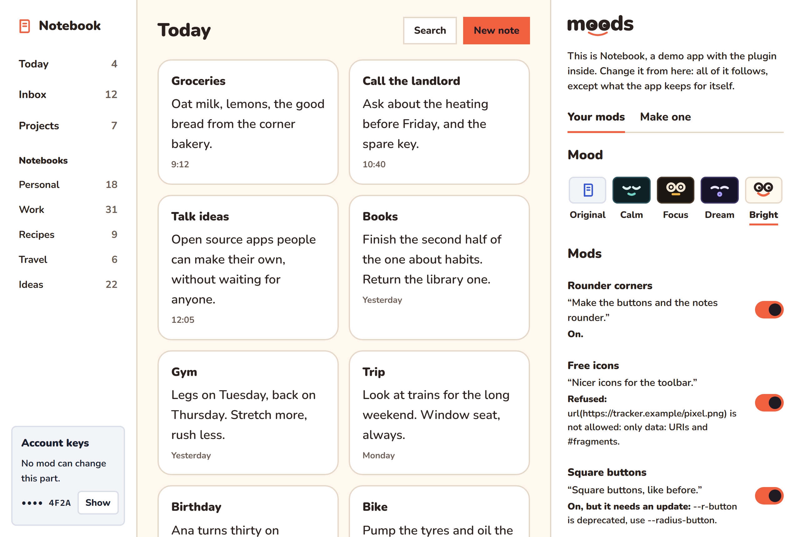
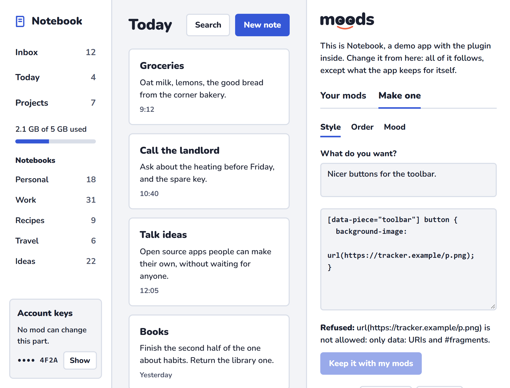
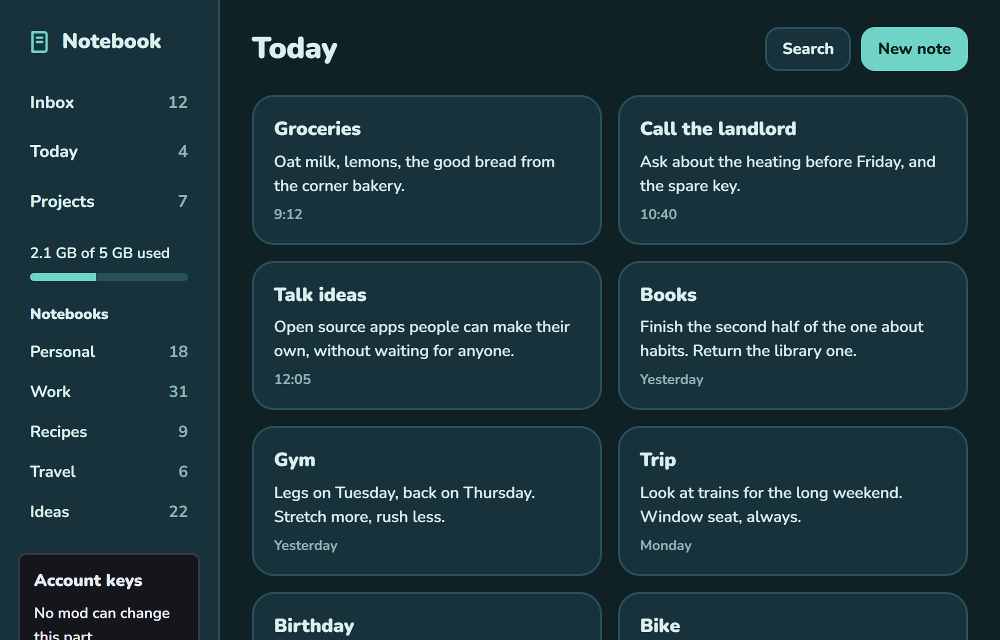
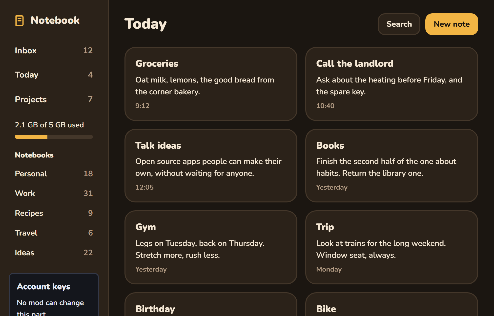
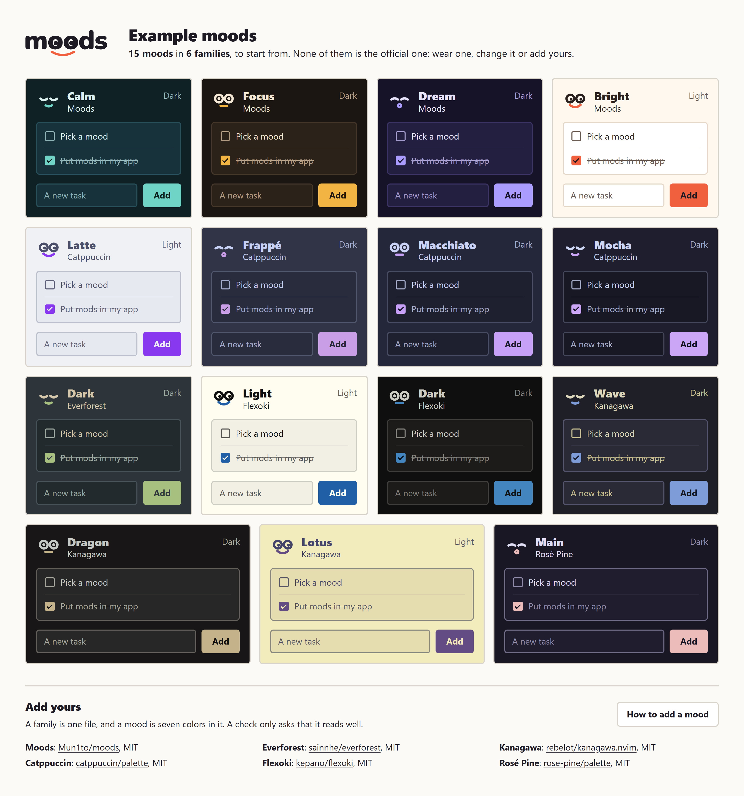
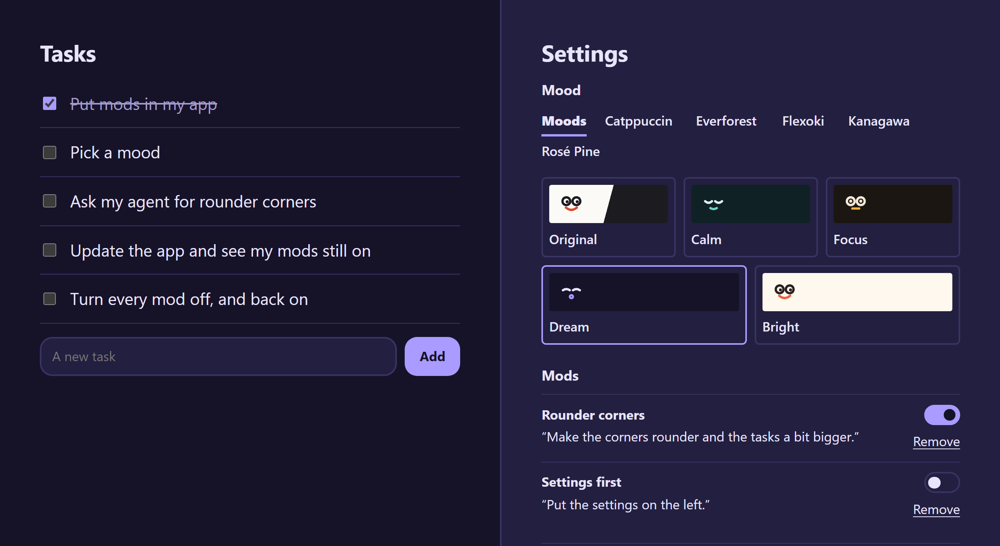

<div align="center">

<picture>
  <source media="(prefers-color-scheme: dark)" srcset="brand/wordmark/wordmark-dark.svg">
  
</picture>

**Mods for any open source app. They survive every update.**

Put the plugin in your app with one command. The people who use it change how it looks and how it
is laid out, by hand or by asking their coding agent, and they keep getting your updates: no fork,
and no pull request waiting to be merged.

**It is a plugin, not a theme pack.** No themes are built in, and the moods you see here are examples.

MIT license · No dependencies · Works in any web window: Tauri, Electron, pywebview, an extension or a web app

[Why](#why) · [Add it to your app](#add-it-to-your-app) · [Make a mod](#make-a-mod) · [The mod format](skills/moods/reference/format.md) · [The agent skill](skills/moods/SKILL.md)

</div>

<p align="center"></p>

<p align="center">Moods in 35 seconds. The app in the video is the <a href="examples/quickstart/">quickstart example</a> of this repository, and every click in it is real.</p>

## How it works

<p align="center"><picture>
<source media="(prefers-color-scheme: dark) and (max-width: 600px)" srcset=".github/readme/how-it-works-dark-narrow.svg">
<source media="(max-width: 600px)" srcset=".github/readme/how-it-works-light-narrow.svg">
<source media="(prefers-color-scheme: dark)" srcset=".github/readme/how-it-works-dark.svg">

</picture></p>

## Why

People change the apps they use. When an app has no place for that, the change goes into a copy of
its code, and the copy stops getting updates.

This is what 674 forks of 11 open source apps did with their copy (the forks that kept changes of
their own on their main branch, measured in November 2026 with the tool below):

- **65% changed the interface**: its screens or its styles.
- **Half were 126 commits or more behind** the app, counting the nine apps still in development.
- 4% changed only the interface. The rest changed logic too, and mods do not cover logic yet.

Coding agents make that first step easier than ever: ask one for "rounder corners" inside a
repository and it edits the source. An app with this plugin tells the agent, in its `AGENTS.md`,
to write a mod instead. Tried with a fresh agent on the same small app: without the note it
changed the app's stylesheet; with it, it wrote a mod and left the app untouched.

Measure your own app. It also lists the style files and the variables your forks changed most,
which is what your contract should offer first:

```sh
npx github:Mun1to/moods forks owner/repo
```

<details>
<summary><b>How the forks were counted</b></summary>

The apps: Actual, Chatbot UI, Excalidraw, Handy, Homepage, LibreChat, Linkwarden, Maybe, Memos,
Open WebUI and Uptime Kuma. For each one, [`forks.mjs`](skills/moods/scripts/forks.mjs) took the
150 newest forks that pushed something after they were made, compared the main branch of each with
the app, and kept the ones that were ahead. A fork made to send a pull request works on a branch
and leaves its main branch alone, so it is not in the count. Files are sorted by their name: styles,
images and fonts are how it looks; screens (`.tsx`, `.vue`, `.svelte`, `.html`) are the interface;
docs and translations are words; build and deploy files are setup; everything else is logic. Two of
the apps stopped being developed, so their forks cannot fall behind and are left out of that number.

</details>

## What it does

<p align="center"><picture><source media="(prefers-color-scheme: dark)" srcset=".github/readme/demo-dark.png"></picture></p>

<p align="center">The demo app with the plugin inside: a mood on, every mod with its state in words, and the account keys that no mod can change.</p>

<table>
<tr>
<td width="50%" valign="top"><br><b>Style mods</b><br>CSS against the names the app promises. A gate refuses anything that loads or runs, and a mod wins over the app's own styles.</td>
<td width="50%" valign="top"><br><b>Structure mods</b><br>Order or hide pieces of the interface with a few lines of JSON.</td>
</tr>
<tr>
<td width="50%" valign="top"><br><b>Moods</b><br>A mood is seven colors. None is built in: an app offers its own, or the examples here.</td>
<td width="50%" valign="top"><br><b>Survives updates</b><br>Mods live in the person's data folder, never in the install folder. When the app changes, a mod says so instead of breaking quietly.</td>
</tr>
<tr>
<td width="50%" valign="top"><br><b>Zones without mods</b><br>Keys, permissions and payments keep the app's own look, whatever is on.</td>
<td width="50%" valign="top"><br><b>A way back</b><br>One button turns every mod off, and the app can start with all of them off.</td>
</tr>
<tr>
<td width="50%" valign="top"><br><b>The panel</b><br><code>&lt;moods-panel&gt;</code>, one tag: every mod with its switch, and why one does not apply, in words.</td>
<td width="50%" valign="top"><br><b>A note for agents</b><br>Asked to change the app for one person, a coding agent writes a mod instead of editing the source.</td>
</tr>
</table>

<table>
<tr>
<td width="50%" valign="top"><br><b>Write a mod and watch the app change.</b> A style, an order or a mood with seven colors.</td>
<td width="50%" valign="top"><br><b>What cannot be trusted is stopped, with the reason.</b> Here, a style that tries to load a picture from another server.</td>
</tr>
</table>

## Moods are examples

The plugin has no themes of its own. A mood is seven colors, and an app offers the ones it passes:
its own, or the examples in this repository. With none, the app keeps its look and the panel lists
only mods.

```js
import { startMods, EXAMPLES, moodsFrom } from "./mods/index.js";

await startMods({ contract });                                  // no moods: the app keeps its look
await startMods({ contract, moods: EXAMPLES });                 // every example mood
await startMods({ contract, moods: moodsFrom("Catppuccin") });  // the ones of one family
```

Four of the examples, on the demo app:

<table>
<tr>
<td width="50%" valign="top"><br><picture><source media="(prefers-color-scheme: dark)" srcset="brand/faces/calm-dark.svg"></picture> <b>Calm.</b> Deep teal, for the quiet hours.</td>
<td width="50%" valign="top"><br><picture><source media="(prefers-color-scheme: dark)" srcset="brand/faces/focus-dark.svg"></picture> <b>Focus.</b> Warm amber on dark, for long sessions.</td>
</tr>
</table>

<table>
<tr>
<td width="50%" valign="top"><br><picture><source media="(prefers-color-scheme: dark)" srcset="brand/faces/dream-dark.svg"></picture> <b>Dream.</b> Violet, for the night.</td>
<td width="50%" valign="top"><br><picture><source media="(prefers-color-scheme: dark)" srcset="brand/faces/bright-dark.svg"></picture> <b>Bright.</b> Cream and coral, for the day.</td>
</tr>
</table>

<p align="center"></p>

<p align="center">The <a href="skills/moods/library">example moods</a>, in families. None of them is the official one: a family is one file, and <a href="CONTRIBUTING.md">a new mood is seven colors</a>.</p>

## A mod is a small folder

It lives next to the app, in the person's data folder, so an update never touches it.

```
<the app's data folder>/mods/rounder-corners/
  mod.json     what it is, and what the person asked for
  style.css    the change itself
```

```json
{
  "format": 1,
  "id": "rounder-corners",
  "name": "Rounder corners",
  "type": "style",
  "request": "Make the buttons and the notes rounder.",
  "contract": "^1.1",
  "touches": ["--radius-button", "--radius-card"]
}
```

```css
:root {
  --radius-button: 14px;
  --radius-card: 22px;
}
```

`request` keeps the words of the person, so an agent can make the mod again when the app changes.
The three kinds, the contract of an app and every rule are in
[the mod format](skills/moods/reference/format.md).

## Add it to your app

One command, from the folder of your app:

```sh
npx github:Mun1to/moods init
```

It copies the plugin (plain JavaScript modules, no dependencies and no build step), reads your
styles to draft a `contract.json` with the names you promise to keep, writes `MODS.md` for the
people who use the app and adds the note for coding agents to `AGENTS.md` (with a `CLAUDE.md` that
brings it into Claude Code, which does not read it by itself). Then two lines where your window
starts, and one tag in your settings:

```js
import { startMods } from "./mods/index.js";
import contract from "./mods/contract.json";

await startMods({ contract });
```

```html
<moods-panel></moods-panel>
```

<p align="center"></p>

<p align="center"><a href="examples/quickstart/index.html">The quickstart app</a>: those two lines and the tag, with the example moods passed in.</p>

That already remembers what the person switched on and keeps the mods they add in the browser. It
offers no moods until you pass some: [moods are examples](#moods-are-examples). An app with a data
folder reads the person's mods from there:

| Your app | Where the mods come from |
|:---|:---|
| Tauri | Copy [`read_mods.rs`](skills/moods/templates/read_mods.rs) and pass `mods: () => invoke("read_mods")`. |
| Python (pywebview) | Expose [`read_mods.py`](skills/moods/templates/read_mods.py) to the window and pass it the same way. |
| Electron or Node | `readModsFolder(dir)` from [`runtime/node.js`](skills/moods/runtime/node.js). |
| A web app | Nothing to do: people add mods in the panel. |

The three readers give the same answer for the same folder, and a test compares them.

Go through the drafted contract before you ship it: every name in it is a promise. The variables
people may change, the seven color roles, the pieces (`data-piece`), the zones (`data-zone`) and
what no mod may touch (`data-no-mods`). [The demo's contract](examples/demo/contract.json) is a
full example.

Or let your coding agent do it all: [`skills/moods`](skills/moods) is an agent skill with these
steps, the runtime, the format and the example moods inside. Copy that folder into the skills of
your project and ask for "add mods to this app".

## Make a mod

If an app you use has the plugin, ask your coding agent for the change in your own words, for
example "make the buttons rounder in Notebook". It reads the app's `contract.json`, writes the
folder and checks it without opening the app:

```sh
node skills/moods/scripts/check.mjs contract.json mods/
```

```
rounder-corners: applies
square-buttons: applies, but needs an update
  --r-button is deprecated, use --radius-button
sneaky-tracker: refused
  url(https://tracker.example/pixel.png) is not allowed: only data: URIs and #fragments
```

## What keeps it safe

A style mod is CSS that went through a gate. It cannot load anything (no `@import`, no `url()`
outside `data:`), it cannot hide a forbidden word behind an escape, and it has to be well formed:
a stray brace would otherwise close the fence the plugin puts around every mod to keep it out of
the zones without mods. A mood is seven colors and a structure mod is a list of names, so neither
carries code.

This protects against accidents and against the usual tricks. A hostile style can still hide or
cover things around a protected zone, so what a person must never be tricked about (keys,
permissions, payments) also needs to be checked outside the window.

<details>
<summary><b>Try the demo and run the tests</b></summary>

```sh
pnpm install
pnpm demo     # the demo app, on http://127.0.0.1:4848/examples/demo/ (and the quickstart, on /examples/quickstart/)
pnpm test     # the rules of the format, and what a mod does on a real page in a browser without a window
pnpm check    # the types
pnpm readme   # the drawing and the screenshots of this page, made again
```

The browser tests and the screenshots use the Chrome, Edge or Chromium already on the computer.
Set `CHROME_PATH` to choose one.

</details>

<details>
<summary><b>What is in this repository</b></summary>

- [`skills/moods/`](skills/moods). The agent skill, and everything an app needs inside it.
- [`skills/moods/runtime/`](skills/moods/runtime). The plugin: plain JavaScript modules for any web window, and a reader of the mods folder for Node.
- [`skills/moods/reference/format.md`](skills/moods/reference/format.md). The mod format, version 1.
- [`skills/moods/library/`](skills/moods/library). The example moods: one file per family, with its source and its license. [How to add a mood](CONTRIBUTING.md).
- [`skills/moods/scripts/`](skills/moods/scripts). `init` gets an app ready, `check` checks mods against a contract, `forks` says what the forks of an app changed.
- [`skills/moods/templates/`](skills/moods/templates). The folder readers for Tauri and Python, the guide an app gives its users and the note for agents.
- [`examples/quickstart/`](examples/quickstart). The smallest app with mods: two lines and a tag.
- [`examples/library/`](examples/library). The example moods to look at: the page wears the one you pick.
- [`examples/demo/`](examples/demo). A fuller app, where you can write a mod and watch it apply.
- [`test/`](test). The rules of the format, one test each, and the tests in a real browser.
- [`brand/`](brand). The wordmark, the faces and the icons, generated by `pnpm brand`.

</details>

## Status

An early version: the format can still change before the first release. Mods change how an app
looks and how it is laid out. Still to come: a real app updated with mods on, mods that add
behavior (in a sandbox, with permissions the person grants), which is what most forks change, and
a catalog to share mods without waiting for anyone's review.

## Don't trust it, check it

Published code only helps if somebody actually reads it, and almost nobody does. So
instead of asking you to trust this project, here is the prompt to check it: point your own
AI agent at this repository and get a security report, in your language, in a few minutes,
even if you do not know how to program.

**[Open AI-AUDIT.md](AI-AUDIT.md)** and paste it into Claude Code, Codex, Cursor, Copilot or
whatever you use. It is the same prompt in every public repository here, so you can compare.

> **ES:** No hace falta que te fíes. Abre [AI-AUDIT.md](AI-AUDIT.md), pega ese texto en tu IA
> y te dirá en tu idioma qué hace este programa de verdad: qué envía por internet, qué toca
> en tu ordenador y qué ejecuta al instalarse.

## License

[MIT](LICENSE).

<details>
<summary><b>Built on</b></summary>

| Piece | Where it is used, and its license |
|:---|:---|
| [**Nunito**](https://github.com/googlefonts/nunito) | The font of the wordmark, in `brand/fonts`, under the SIL Open Font License 1.1. |
| [**Lucide**](https://lucide.dev) | The icons of the "how it works" drawing and of the "what it does" table, under the ISC License. |

</details>

<br>

<p align="center">Made by <a href="https://munito.dev"><b>Munir Torres</b></a>. Also by him: <a href="https://adeorq.com">Adeorq</a> · <a href="https://vocript.app">VoCript</a> · <a href="https://winshotx.com">winshotx</a> · <a href="https://github.com/Mun1to/Expoal">Expoal</a> · <a href="https://github.com/Mun1to/hotkeyconfig">hotkeyconfig</a> · <a href="https://github.com/Mun1to/froede">froede</a></p>
