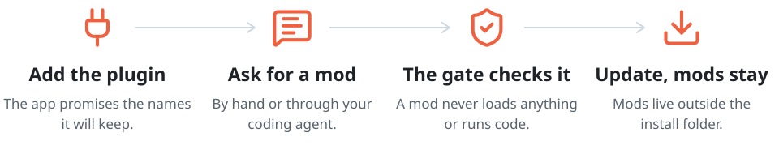
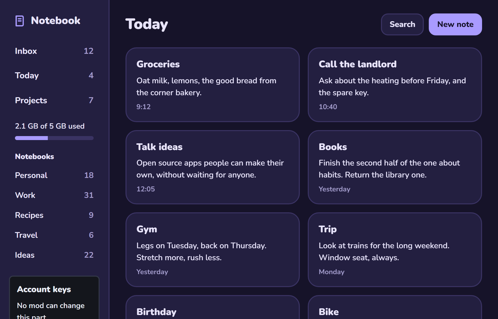
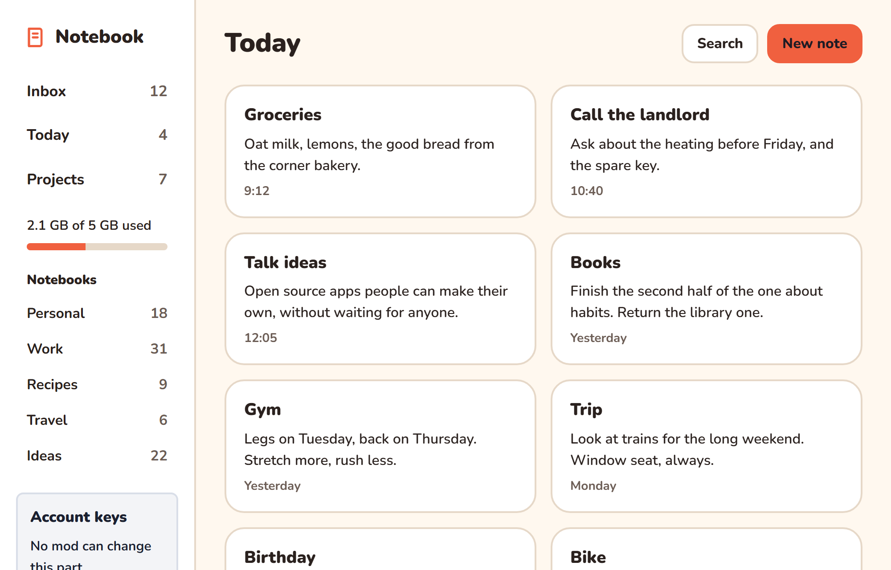
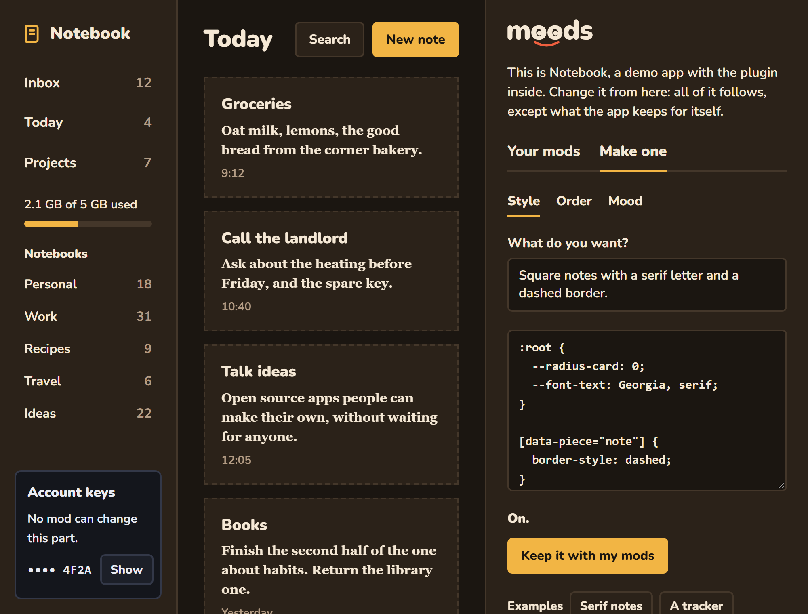

<div align="center">

<picture>
  <source media="(prefers-color-scheme: dark)" srcset="brand/wordmark/wordmark-dark.svg">
  
</picture>

**Mods for any open source app. They survive every update.**

Put the plugin in your app and the people who use it can change how it looks and how it is laid
out, by hand or by asking their coding agent, without forking it and without waiting for a pull
request to be merged.

MIT license · No dependencies · Works in any web window: Tauri, Electron, pywebview, an extension or a web app

[How it works](#how-it-works) · [Add it to your app](#add-it-to-your-app) · [Make a mod](#make-a-mod) · [The mod format](skills/moods/reference/format.md) · [The agent skill](skills/moods/SKILL.md)

</div>

<p align="center"><picture><source media="(prefers-color-scheme: dark)" srcset=".github/readme/demo-dark.png"></picture></p>

<p align="center">The demo app with the plugin inside: a mood on, every mod with its state in words, and the account keys that no mod can change.</p>

## How it works

<p align="center"><picture>
<source media="(prefers-color-scheme: dark) and (max-width: 600px)" srcset=".github/readme/how-it-works-dark-narrow.svg">
<source media="(max-width: 600px)" srcset=".github/readme/how-it-works-light-narrow.svg">
<source media="(prefers-color-scheme: dark)" srcset=".github/readme/how-it-works-dark.svg">

</picture></p>

## What it does

| | |
|---|---|
| **Moods** | Four ready palettes: Calm, Focus, Dream and Bright. An app maps seven color roles once, and every mood works in it. |
| **Style mods** | CSS written against the names the app promises in its `contract.json`. A gate refuses anything that loads or runs. |
| **Structure mods** | Order or hide pieces of the interface with a few lines of JSON, without moving the app's own DOM. |
| **Zones without mods** | What no mod should touch (keys, permissions, payments) keeps the app's own look, whatever is on. |
| **Mods win** | A mod beats the app's own styles, also the inline ones, so it works the same in every app. |
| **Survives updates** | Mods live in the person's data folder, never in the install folder, and are checked against the app's contract on every start. When the app changes, a mod says so instead of breaking quietly. |
| **A way back** | Every mod can be turned off at once, and the app can start with all of them off. |

## Four moods to start with

<table>
<tr>
<td width="50%" valign="top"><br><picture><source media="(prefers-color-scheme: dark)" srcset="brand/faces/calm-dark.svg"></picture> <b>Calm.</b> Deep teal, for the quiet hours.</td>
<td width="50%" valign="top"><br><picture><source media="(prefers-color-scheme: dark)" srcset="brand/faces/focus-dark.svg"></picture> <b>Focus.</b> Warm amber on dark, for long sessions.</td>
</tr>
</table>

<table>
<tr>
<td width="50%" valign="top"><br><picture><source media="(prefers-color-scheme: dark)" srcset="brand/faces/dream-dark.svg"></picture> <b>Dream.</b> Violet, for the night.</td>
<td width="50%" valign="top"><br><picture><source media="(prefers-color-scheme: dark)" srcset="brand/faces/bright-dark.svg"></picture> <b>Bright.</b> Cream and coral, for the day.</td>
</tr>
</table>

<table>
<tr>
<td width="50%" valign="top"><br><b>Write a mod and watch the app change.</b> A style, an order or a mood with seven colors.</td>
<td width="50%" valign="top"><br><b>What cannot be trusted is stopped, with the reason.</b> Here, a style that tries to load a picture from another server.</td>
</tr>
</table>

## A mod is a small folder

It lives next to the app, in the person's data folder, so an update never touches it.

```
<the app's data folder>/mods/rounder-corners/
  mod.json     what it is, and what the person asked for
  style.css    the change itself
```

```json
{
  "format": 1,
  "id": "rounder-corners",
  "name": "Rounder corners",
  "type": "style",
  "request": "Make the buttons and the notes rounder.",
  "contract": "^1.1",
  "touches": ["--radius-button", "--radius-card"]
}
```

```css
:root {
  --radius-button: 14px;
  --radius-card: 22px;
}
```

`request` keeps the words of the person, so an agent can make the mod again when the app changes.
The three kinds, the contract of an app and every rule are in
[the mod format](skills/moods/reference/format.md).

## Add it to your app

The plugin is a folder of plain JavaScript modules: no dependencies and no build step.

1. Copy [`skills/moods/runtime`](skills/moods/runtime) into your app.
2. Write a `contract.json` with the names you promise to keep: the variables people may change,
   the seven color roles, the pieces (`data-piece`), the zones (`data-zone`) and what no mod may
   touch (`data-no-mods`). [The demo's contract](examples/demo/contract.json) is a full example.
3. Read the mods from the person's data folder and apply them after the first render:

```js
import { createModHost } from "./runtime/index.js";

const host = createModHost({ contract });   // your contract.json
const verdicts = host.apply(mods);          // [{ id, state, notes }], it never throws because of a mod
```

4. Show the verdicts in a screen of your own: a switch per mod, its state in words and one button
   that turns every mod off.

Or let your coding agent do it: [`skills/moods`](skills/moods) is an agent skill with these steps,
the runtime, the format and the four moods inside. Copy that folder into the skills of your
project and ask for "add mods to this app".

## Make a mod

If an app you use has the plugin, ask your coding agent for the change in your own words, for
example "make the buttons rounder in Notebook". It reads the app's `contract.json`, writes the
folder and checks it without opening the app:

```sh
node skills/moods/scripts/check.mjs contract.json mods/
```

```
rounder-corners: applies
square-buttons: applies, but needs an update
  --r-button is deprecated, use --radius-button
sneaky-tracker: refused
  url(https://tracker.example/pixel.png) is not allowed: only data: URIs and #fragments
```

## What keeps it safe

A style mod is CSS that went through a gate. It cannot load anything (no `@import`, no `url()`
outside `data:`), it cannot hide a forbidden word behind an escape, and it has to be well formed:
a stray brace would otherwise close the fence the plugin puts around every mod to keep it out of
the zones without mods. A mood is seven colors and a structure mod is a list of names, so neither
carries code.

This protects against accidents and against the usual tricks. A hostile style can still hide or
cover things around a protected zone, so what a person must never be tricked about (keys,
permissions, payments) also needs to be checked outside the window.

<details>
<summary><b>Try the demo and run the tests</b></summary>

```sh
pnpm install
pnpm demo     # the demo app, on http://127.0.0.1:4848/examples/demo/
pnpm test     # the rules of the format, and what a mod does on a real page in a browser without a window
pnpm check    # the types
pnpm readme   # the drawing and the screenshots of this page, made again
```

The browser tests and the screenshots use the Chrome, Edge or Chromium already on the computer.
Set `CHROME_PATH` to choose one.

</details>

<details>
<summary><b>What is in this repository</b></summary>

| Folder | What |
|---|---|
| [`skills/moods/`](skills/moods) | The agent skill, and everything an app needs inside it. |
| [`skills/moods/runtime/`](skills/moods/runtime) | The plugin: plain JavaScript modules for any web window, and a reader of the mods folder for Node. |
| [`skills/moods/reference/format.md`](skills/moods/reference/format.md) | The mod format, version 1. |
| [`skills/moods/moods/`](skills/moods/moods) | The four built-in moods, as real mods. |
| [`skills/moods/scripts/check.mjs`](skills/moods/scripts/check.mjs) | Checks mods against a contract from the command line. |
| [`examples/demo/`](examples/demo) | A small app with the plugin inside. |
| [`test/`](test) | The rules of the format, one test each, and the tests in a real browser. |
| [`brand/`](brand) | The wordmark, the faces and the icons, generated by `pnpm brand`. |

</details>

## Status

An early version: the format can still change before the first release. Next come the loaders
for Tauri (Rust) and pywebview (Python), a real app updated with mods on, and a catalog to share
mods without waiting for anyone's review.

## Don't trust it, check it

Published code only helps if somebody actually reads it, and almost nobody does. So
instead of asking you to trust this project, here is the prompt to check it: point your own
AI agent at this repository and get a security report, in your language, in a few minutes,
even if you do not know how to program.

**[Open AI-AUDIT.md](AI-AUDIT.md)** and paste it into Claude Code, Codex, Cursor, Copilot or
whatever you use. It is the same prompt in every public repository here, so you can compare.

> **ES:** No hace falta que te fíes. Abre [AI-AUDIT.md](AI-AUDIT.md), pega ese texto en tu IA
> y te dirá en tu idioma qué hace este programa de verdad: qué envía por internet, qué toca
> en tu ordenador y qué ejecuta al instalarse.

## License

[MIT](LICENSE).

<details>
<summary><b>Built on</b></summary>

| | |
|---|---|
| [**Nunito**](https://github.com/googlefonts/nunito) | The font of the wordmark, in `brand/fonts`, under the SIL Open Font License 1.1. |
| [**Lucide**](https://lucide.dev) | The four icons of the "how it works" drawing, under the ISC License. |

</details>

<br>

<p align="center">Made by <a href="https://munito.dev"><b>Munir Torres</b></a>. Also by him: <a href="https://adeorq.com">Adeorq</a> · <a href="https://vocript.app">VoCript</a> · <a href="https://winshotx.com">winshotx</a> · <a href="https://github.com/Mun1to/Expoal">Expoal</a> · <a href="https://github.com/Mun1to/hotkeyconfig">hotkeyconfig</a> · <a href="https://github.com/Mun1to/froede">froede</a></p>
